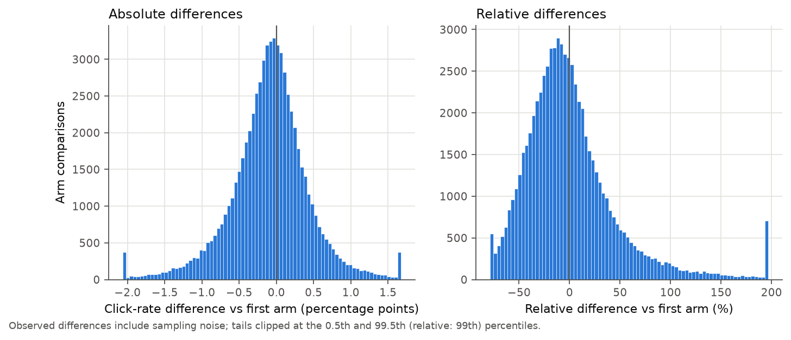
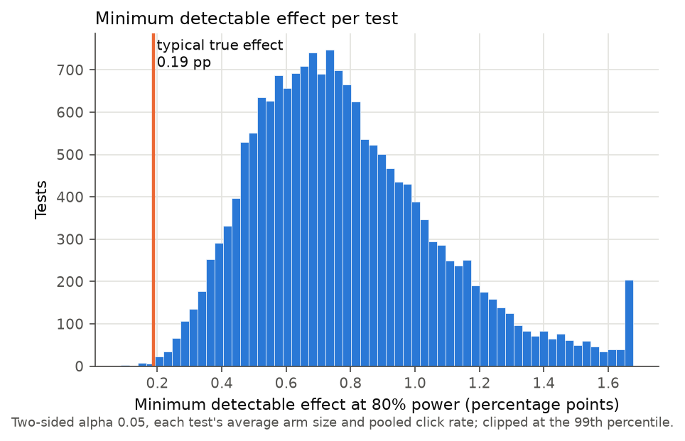
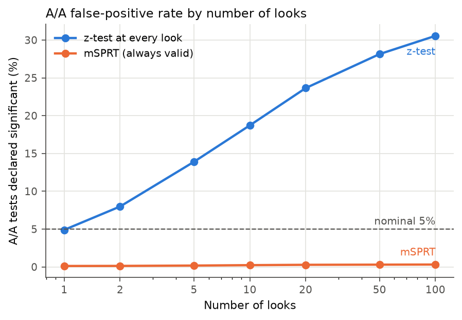
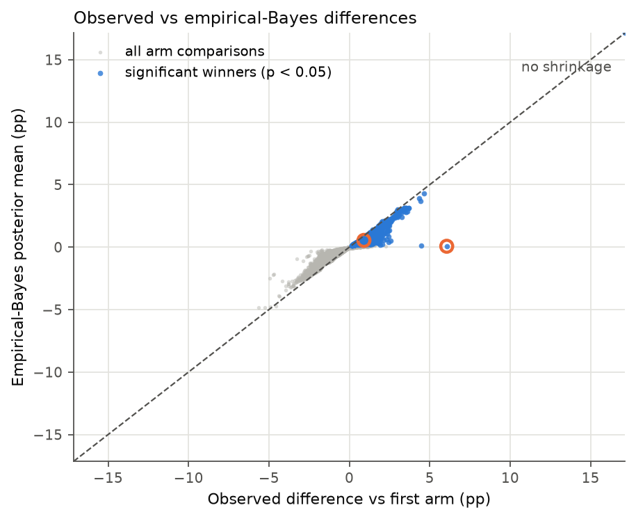

# Confirmatory results

This is the single pre-registered run on the Upworthy confirmatory release, using the definitions, exclusions, seeds and criteria in `ANALYSIS_PLAN.md`. Every number is written by `uv run forensics run --release confirmatory`.

## Exploratory vs confirmatory

| Metric | Exploratory | Confirmatory | Criterion | Met |
|---|---|---|---|---|
| Share of tests in the correction window | 21.5% | 21.6% | within 2 pp of 21.6% | yes |
| SRM p<0.001, inside window | 70.0% | 70.1% | > 25% | yes |
| SRM p<0.001, outside window | 0.5% | 0.5% | < 2% | yes |
| Identical-arm pairs with p<0.05 | 13.3% | 12.9% | > 5% | yes |
| Identical-arm pairs, binomial test vs 5% | 6.9e-12 | 1.3e-42 | p < 0.01 | yes |
| Median |difference| (pp) | 0.271 | 0.281 | descriptive |  |
| Median |relative difference| | 24.5% | 24.8% | descriptive |  |
| Normal prior SD (pp) | 0.362 | 0.380 | descriptive |  |
| Typical true |effect|, grid (pp) | 0.148 | 0.189 | descriptive |  |
| Median relative MDE | 64.1% | 63.4% | descriptive |  |
| Tests powered for the typical effect | 0.03% | 0.08% | < 5% | yes |
| Mean power at the typical effect | 10.3% | 13.3% | < 20% | yes |
| A/A false positives, 1 look | 5.2% | 4.9% | within 1 pp of 5% | yes |
| A/A false positives, 10 looks | 18.9% | 18.7% | >= 10% | yes |
| A/A false positives, 100 looks | 30.4% | 30.6% | >= 20% | yes |
| mSPRT false positives, 100 looks | 0.32% | 0.31% | <= 5.5% | yes |
| Significant winners (share of tests) | 22.2% | 21.4% | descriptive |  |
| Median shrinkage, grid prior | 40.5% | 40.6% | within 10 pp of exploratory | yes |
| Median shrinkage, normal prior | 41.8% | 39.7% | within 10 pp of exploratory | yes |
| Winners with P(true lift > 0) >= 95% | 42.1% | 38.3% | descriptive |  |
| Median shrinkage, grid prior, inflated SEs | 83.3% | 88.3% | descriptive |  |

## Upworthy pipeline checks

The confirmatory file has 105,551 packages in 22,743 tests. The archive paper reports 105,551 packages within 22,743 tests for this release, so the counts match. Clicks never exceed impressions (0 violations). Packages were created between 2013-01-24 14:57:06 and 2015-04-30 02:03:39.370000 (timezone unknown, per the paper). Total impressions: 376,529,158; clicks: 5,741,684. The paper does not give per-release impression or click totals, so those are not checked.

### The randomization correction

Tests whose first package was created from 25 June 2013 through the end of 10 January 2014 are dropped, as the authors' correction recommends. That removes **4,907 of 22,743 tests (21.6%)** and 19,845 packages, leaving 17,836 tests. The correction reports 7,004 affected tests, or 22% of the full archive, so the share here is in line. Flagging a test when any of its packages falls in the window gives 4,910; requiring all of them gives 4,906. Shifting both window edges to allow for the unknown timezone gives: -24h: 4,902, -12h: 4,908, +12h: 4,903, +24h: 4,879.

A sample-ratio check backs the correction up. Within each test, a chi-square test of equal impressions across arms gives p < 0.001 in 70.1% of multi-arm tests inside the window and in 0.5% outside it (median p 1.3e-06 vs 0.44).

**A real A/A check.** Some tests contain two arms that showed viewers exactly the same headline, image ID and excerpt. In the kept tests there are 2011 such pairs. If those arms were fairly randomized and clicks were independent, about 5% of them would differ at p < 0.05. 12.9% do (binomial test against 5%: p = 1.3e-42), and the mean squared z-statistic is 1.92 where 1 is expected.

So click counts vary more between identical arms than binomial sampling allows. The data cannot say why (possible reasons: something about the arms not recorded in the archive, or traffic that was not served evenly over time). It means the naive z-tests below, and the simulations that assume binomial noise, are if anything too optimistic. Section 3 includes a sensitivity check that inflates standard errors by this factor.

## 1. Effect sizes and power

**Definition.** In each test the *reference* arm is the package created first (earliest `created_at`, among arms with at least 100 impressions). Every other arm is compared with it: difference in click rate (arm minus reference) and relative difference (divided by the reference rate). Upworthy had no control arm, and the first-written package is the nearest thing to an original headline. Its identity is fixed before any traffic arrives, so it cannot be chosen by the outcome. Best-vs-rest would build the winner's curse into the definition.

There are 67,851 comparisons in 17,831 tests (21 arms with under 100 impressions dropped). The median reference click rate is 1.21% and the median arm has 3,111 impressions.

| Observed, arm minus reference | 5th | 25th | median | 75th | 95th |
|---|---|---|---|---|---|
| Absolute difference (pp) | -0.99 | -0.37 | -0.07 | 0.19 | 0.72 |
| Relative difference | -57.5% | -28.3% | -6.7% | 18.8% | 87.9% |

The median observed absolute difference is 0.28 pp, or 24.8% in relative terms. 25.0% of comparisons are significant at p < 0.05. The median difference is negative: later arms tend to do slightly worse than the first one.

Observed differences include sampling noise, so they overstate how big true effects are. The empirical-Bayes fits in section 3 deconvolve that noise. The normal prior has mean -0.089 pp and SD 0.380 pp. The nonparametric (grid) prior puts a median absolute true effect of **0.189 pp** (32.7% of its mass is within 0.1 pp of zero; 90th percentile 0.645 pp).

**Power.** For each test, using its average arm size and pooled click rate, the minimum detectable difference at 80% power and two-sided alpha 0.05 has median **0.743 pp** (interquartile range 0.574 to 0.951), or **63% relative**. Only 0.08% of 17,831 tests could detect the typical true effect from the grid prior, and 1.0% could detect the (inflated) median observed difference of 0.281 pp. Average power against the typical true effect is 13.3%.

## 2. Peeking

Each of 20,000 simulated A/A tests draws a real kept test (with replacement), uses its pooled click rate for both arms and its average arm size, and delivers impressions in 100 equal batches. An analyst who checks K times runs a pooled two-proportion z-test after every 100/K batches and stops at the first p < 0.05. The mSPRT (normal mixture, mixing SD 0.36 pp, threshold 1/alpha = 20) looks at the same points. Monte Carlo SE near 5% is 0.15 pp.

| Looks | z-test false-positive rate | mSPRT false-positive rate |
|---|---|---|
| 1 | 4.9% | 0.12% |
| 2 | 8.0% | 0.13% |
| 5 | 13.9% | 0.18% |
| 10 | 18.7% | 0.23% |
| 20 | 23.6% | 0.27% |
| 50 | 28.1% | 0.29% |
| 100 | 30.6% | 0.31% |

The same simulation with a true relative lift in the second arm shows how much power each approach keeps:

| True lift | z-test, one look at the end | mSPRT, 10 looks | mSPRT, 100 looks |
|---|---|---|---|
| 10% | 7.3% | 0.2% | 0.4% |
| 25% | 21.0% | 1.8% | 2.2% |
| 50% | 53.0% | 11.6% | 13.3% |

At these sample sizes the always-valid test gives up a lot of power compared with a single look at the planned end; it buys honest error rates with power the tests did not have to spare.

## 3. Winner's curse

Per test, the *winner* is the non-reference arm with the highest observed click rate, kept when it beats the reference. 12,655 tests have one, and **3,820 (21.4% of tests)** beat the reference at p < 0.05. Their median observed lift is 0.785 pp (86% relative).

Two priors are fit to all comparisons (not just winners), each observed difference treated as normal around its true value with its own standard error: a normal prior by maximum marginal likelihood, and a nonparametric prior on a 301-point grid fit by EM (an NPMLE). The posterior mean is the best guess for what a re-run would show. Shrinkage is 1 minus posterior mean over observed lift.

| Among significant winners | Grid prior | Normal prior |
|---|---|---|
| Median shrinkage | 40.6% | 39.7% |
| Median posterior lift (pp) | 0.406 | 0.434 |

Under the grid prior, 38.3% of significant winners have at least a 95% posterior probability of truly beating the reference.

Sensitivity: inflating every standard error by the square root of 1.92 (the identical-arm variance ratio) raises median shrinkage to 88.3%, and only 49.6% of the significant winners would still clear p < 0.05.

**The winner that shrinks most (in percentage points).** Test `52e9a64344fd73cacf000023`.

- Reference: "Watch A Congressman Threaten To Physically Harm A Reporter For Asking The Wrong Question" (1 clicks / 111)
- Winner: "Reporter Asks The Wrong Question, Politician Threatens To Throw Reporter Off A Balcony" (8 clicks / 115)
- Observed lift 6.06 pp (672% relative), p = 0.02. Posterior mean 0.07 pp (grid) or 0.04 pp (normal); shrinkage 98.8% under the grid prior.

**A typical significant winner (median shrinkage).** Test `53208267c532cf5ce700003d`.

- Reference: "HIV-Positive, Homeless, And Gay In New York At The Age Of 16? Give This Story A Listen." (22 clicks / 2,665)
- Winner: "HIV-Positive, Homeless, And Gay In New York At The Age Of 16? Give This Story A Listen." (45 clicks / 2,597) (same headline, different image ID)
- Observed lift 0.91 pp (110% relative), p = 0.0033. Posterior mean 0.54 pp (grid) or 0.51 pp (normal); shrinkage 40.6% under the grid prior.
