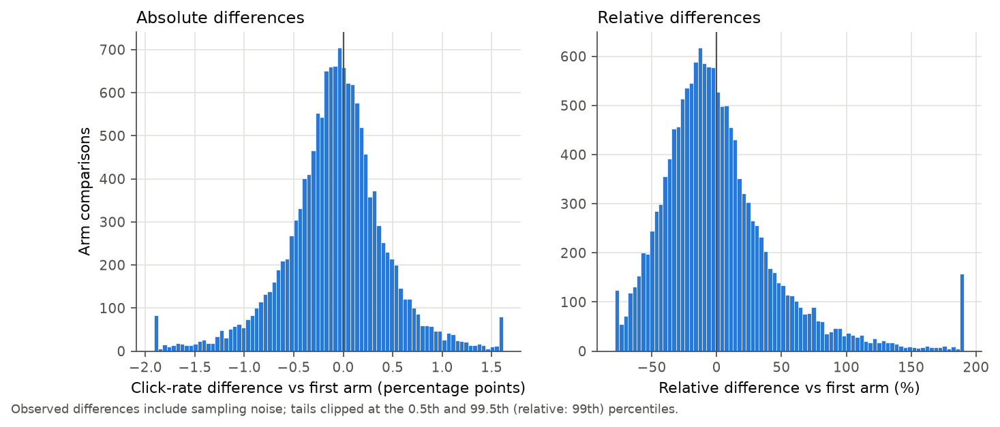
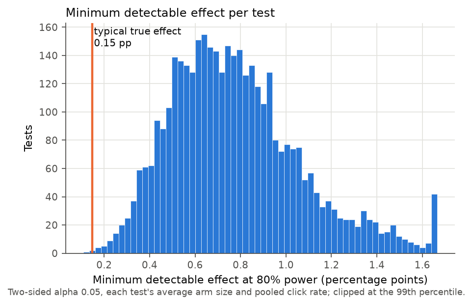
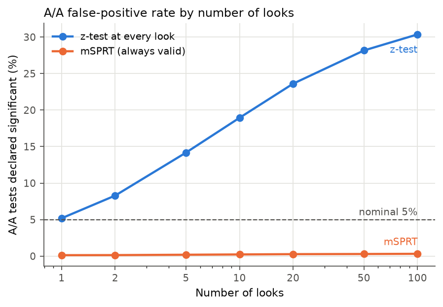
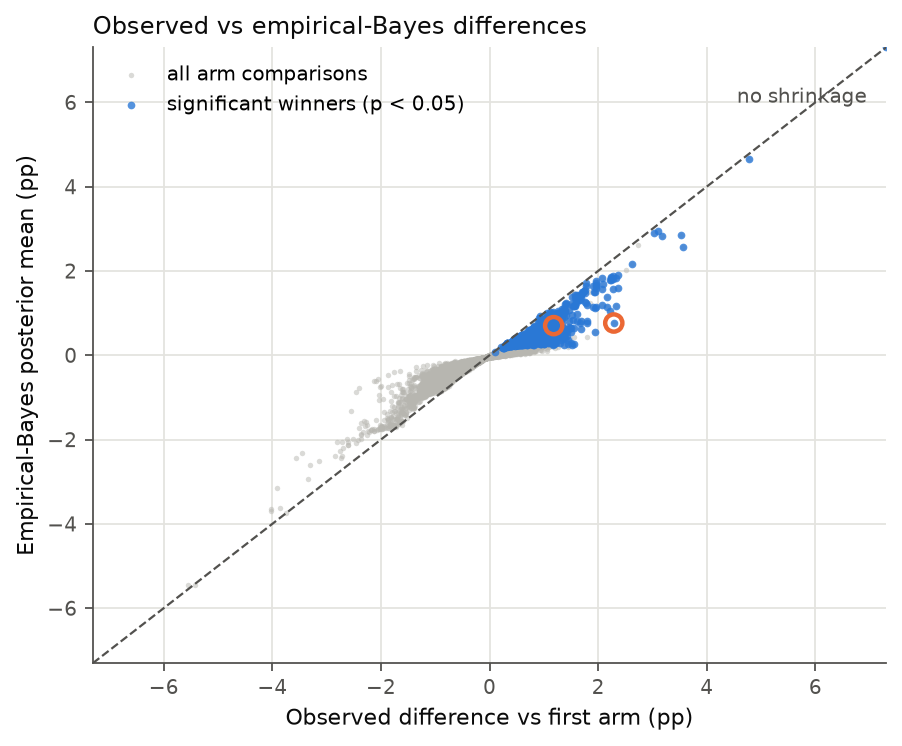
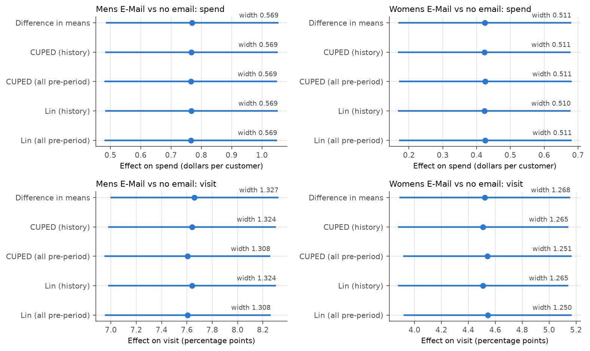
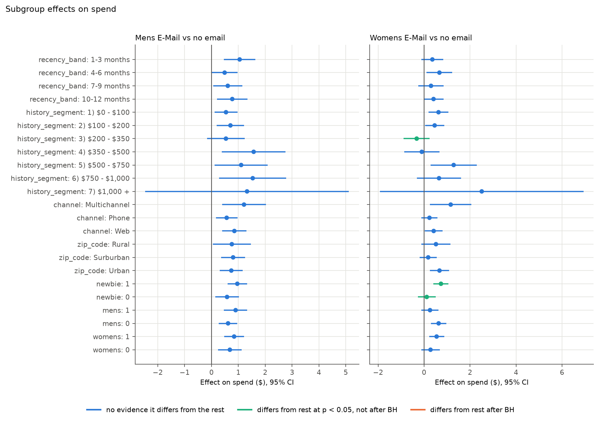
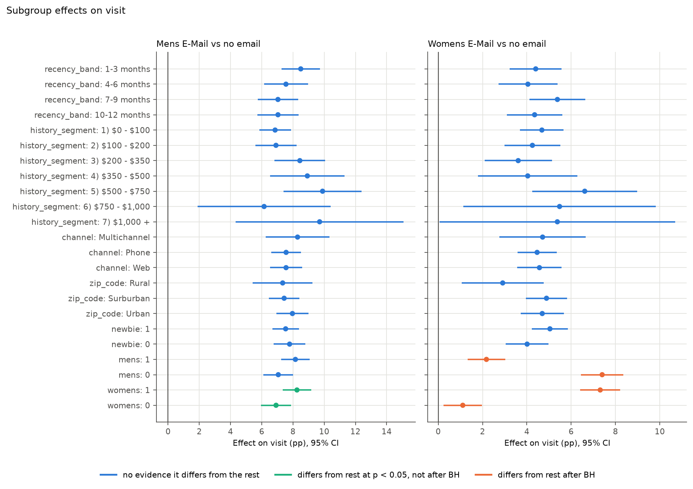

# Exploratory results

Upworthy exploratory release (after the randomization exclusion) and the Hillstrom email test. Every number here is written by `uv run forensics run --release exploratory`; the raw values are in `reports/results_exploratory.json`. The analysis choices for the confirmatory run are frozen in `ANALYSIS_PLAN.md`.

## Upworthy pipeline checks

The exploratory file has 22,666 packages in 4,873 tests. The archive paper reports 22,666 packages within 4,873 tests for this release, so the counts match. Clicks never exceed impressions (0 violations). Packages were created between 2013-01-26 20:10:36 and 2015-04-29 22:46:43.618000 (timezone unknown, per the paper). Total impressions: 81,024,151; clicks: 1,231,208. The paper does not give per-release impression or click totals, so those are not checked.

### The randomization correction

Tests whose first package was created from 25 June 2013 through the end of 10 January 2014 are dropped, as the authors' correction recommends. That removes **1,050 of 4,873 tests (21.5%)** and 4,278 packages, leaving 3,823 tests. The correction reports 7,004 affected tests, or 22% of the full archive, so the share here is in line. Flagging a test when any of its packages falls in the window gives 1,050; requiring all of them gives 1,050. Shifting both window edges to allow for the unknown timezone gives: -24h: 1,047, -12h: 1,048, +12h: 1,051, +24h: 1,044.

A sample-ratio check backs the correction up. Within each test, a chi-square test of equal impressions across arms gives p < 0.001 in 70.0% of multi-arm tests inside the window and in 0.5% outside it (median p 1.4e-06 vs 0.45).

**A real A/A check.** Some tests contain two arms that showed viewers exactly the same headline, image ID and excerpt. In the kept tests there are 460 such pairs. If those arms were fairly randomized and clicks were independent, about 5% of them would differ at p < 0.05. 13.3% do (binomial test against 5%: p = 6.9e-12), and the mean squared z-statistic is 1.80 where 1 is expected.

So click counts vary more between identical arms than binomial sampling allows. The data cannot say why (possible reasons: something about the arms not recorded in the archive, or traffic that was not served evenly over time). It means the naive z-tests below, and the simulations that assume binomial noise, are if anything too optimistic. Section 3 includes a sensitivity check that inflates standard errors by this factor.

## 1. Effect sizes and power

**Definition.** In each test the *reference* arm is the package created first (earliest `created_at`, among arms with at least 100 impressions). Every other arm is compared with it: difference in click rate (arm minus reference) and relative difference (divided by the reference rate). Upworthy had no control arm, and the first-written package is the nearest thing to an original headline. Its identity is fixed before any traffic arrives, so it cannot be chosen by the outcome. Best-vs-rest would build the winner's curse into the definition.

There are 14,561 comparisons in 3,822 tests (4 arms with under 100 impressions dropped). The median reference click rate is 1.18% and the median arm has 3,118 impressions.

| Observed, arm minus reference | 5th | 25th | median | 75th | 95th |
|---|---|---|---|---|---|
| Absolute difference (pp) | -0.93 | -0.34 | -0.06 | 0.20 | 0.72 |
| Relative difference | -56.6% | -27.2% | -5.7% | 19.9% | 84.1% |

The median observed absolute difference is 0.27 pp, or 24.5% in relative terms. 23.6% of comparisons are significant at p < 0.05. The median difference is negative: later arms tend to do slightly worse than the first one.

Observed differences include sampling noise, so they overstate how big true effects are. The empirical-Bayes fits in section 3 deconvolve that noise. The normal prior has mean -0.074 pp and SD 0.362 pp. The nonparametric (grid) prior puts a median absolute true effect of **0.148 pp** (38.1% of its mass is within 0.1 pp of zero; 90th percentile 0.576 pp).

**Power.** For each test, using its average arm size and pooled click rate, the minimum detectable difference at 80% power and two-sided alpha 0.05 has median **0.742 pp** (interquartile range 0.569 to 0.936), or **64% relative**. Only 0.03% of 3,822 tests could detect the typical true effect from the grid prior, and 1.0% could detect the (inflated) median observed difference of 0.271 pp. Average power against the typical true effect is 10.3%.

## 2. Peeking

Each of 20,000 simulated A/A tests draws a real kept test (with replacement), uses its pooled click rate for both arms and its average arm size, and delivers impressions in 100 equal batches. An analyst who checks K times runs a pooled two-proportion z-test after every 100/K batches and stops at the first p < 0.05. The mSPRT (normal mixture, mixing SD 0.36 pp, threshold 1/alpha = 20) looks at the same points. Monte Carlo SE near 5% is 0.15 pp.

| Looks | z-test false-positive rate | mSPRT false-positive rate |
|---|---|---|
| 1 | 5.2% | 0.13% |
| 2 | 8.3% | 0.14% |
| 5 | 14.2% | 0.19% |
| 10 | 18.9% | 0.23% |
| 20 | 23.6% | 0.27% |
| 50 | 28.2% | 0.29% |
| 100 | 30.4% | 0.32% |

The same simulation with a true relative lift in the second arm shows how much power each approach keeps:

| True lift | z-test, one look at the end | mSPRT, 10 looks | mSPRT, 100 looks |
|---|---|---|---|
| 10% | 7.3% | 0.3% | 0.4% |
| 25% | 20.7% | 1.7% | 2.2% |
| 50% | 53.0% | 11.8% | 13.4% |

At these sample sizes the always-valid test gives up a lot of power compared with a single look at the planned end; it buys honest error rates with power the tests did not have to spare.

## 3. Winner's curse

Per test, the *winner* is the non-reference arm with the highest observed click rate, kept when it beats the reference. 2,770 tests have one, and **847 (22.2% of tests)** beat the reference at p < 0.05. Their median observed lift is 0.781 pp (83% relative).

Two priors are fit to all comparisons (not just winners), each observed difference treated as normal around its true value with its own standard error: a normal prior by maximum marginal likelihood, and a nonparametric prior on a 301-point grid fit by EM (an NPMLE). The posterior mean is the best guess for what a re-run would show. Shrinkage is 1 minus posterior mean over observed lift.

| Among significant winners | Grid prior | Normal prior |
|---|---|---|
| Median shrinkage | 40.5% | 41.8% |
| Median posterior lift (pp) | 0.405 | 0.418 |

Under the grid prior, 42.1% of significant winners have at least a 95% posterior probability of truly beating the reference.

Sensitivity: inflating every standard error by the square root of 1.80 (the identical-arm variance ratio) raises median shrinkage to 83.3%, and only 54.8% of the significant winners would still clear p < 0.05.

**The winner that shrinks most (in percentage points).** Test `54e4cf5f373139001a900000`.

- Reference: "A comic about bullying with an ending I did not see coming *at all.*" (46 clicks / 1,510)
- Winner: "The bully punches him in the face. Later, he follows the bully home, and that's where he sees it." (84 clicks / 1,575)
- Observed lift 2.29 pp (75% relative), p = 0.0016. Posterior mean 0.76 pp (grid) or 0.40 pp (normal); shrinkage 66.6% under the grid prior.

**A typical significant winner (median shrinkage).** Test `548e2c1b6539330018000000`.

- Reference: "The Moment This Comedian Stopped Getting Laughs, His Life Changed Forever" (44 clicks / 3,030)
- Winner: "The Moment This Comedian Stopped Getting Laughs From His Audience, His Life Changed Forever" (79 clicks / 3,001)
- Observed lift 1.18 pp (81% relative), p = 0.0012. Posterior mean 0.70 pp (grid) or 0.55 pp (normal); shrinkage 40.5% under the grid prior.

## Hillstrom pipeline checks

| Segment | Customers | Visit | Conversion | Mean spend |
|---|---|---|---|---|
| Mens E-Mail | 21,307 | 18.28% | 1.25% | $1.423 |
| No E-Mail | 21,306 | 10.62% | 0.57% | $0.653 |
| Womens E-Mail | 21,387 | 15.14% | 0.88% | $1.077 |

64,000 rows, split into three groups of about 21.3k each, as the challenge describes (one third each). The scikit-uplift documentation lists an average visit rate of .15 and conversion rate of .009 and spend from 0 to 499; here they are 0.1468, 0.00903 and 0 to 499.

**Units of `history`.** Hillstrom's description: actual dollar value spent in the past year. Values run from $29.99 to $3,345.93 (median $158.11), and 100.0% fall inside their own `history_segment` dollar bracket, so it is dollars, measured before the campaign. Spend is positive for only 0.90% of customers (exactly the converters; 0 customers have spend without a conversion).

**Balance.** Across 11 pre-treatment covariates (recency, history, mens, womens, newbie, and indicators for each zip_code and channel level), the largest standardized mean difference between an email arm and the control is 0.014 and the smallest omnibus p-value across the three arms is 0.22. Randomization looks fine.

## 4. Variance reduction on Hillstrom

Estimators, each for one email vs no email: difference in means (Welch SE); CUPED with pre-period `history`, theta estimated on both arms pooled; CUPED with all pre-period covariates; Lin's regression adjustment (treatment, centred covariates and their interactions, HC2 robust SE) with `history` only and with all pre-period covariates. "All pre-period" means history, recency, mens, womens, newbie and dummies for zip_code, channel and history_segment. Nothing measured after the email is used.

| Email | Outcome | Estimator | Effect | 95% CI | CI width | Variance reduction | Equivalent sample multiplier |
|---|---|---|---|---|---|---|---|
| Mens E-Mail | spend | Difference in means | 0.770 $ | [0.485, 1.055] | 0.5694 | 0.00% | 1.0000 |
| Mens E-Mail | spend | CUPED (history) | 0.767 $ | [0.483, 1.052] | 0.5692 | 0.04% | 1.0004 |
| Mens E-Mail | spend | CUPED (all pre-period) | 0.765 $ | [0.481, 1.050] | 0.5689 | 0.15% | 1.0015 |
| Mens E-Mail | spend | Lin (history) | 0.767 $ | [0.483, 1.052] | 0.5690 | 0.14% | 1.0014 |
| Mens E-Mail | spend | Lin (all pre-period) | 0.765 $ | [0.481, 1.050] | 0.5695 | -0.04% | 0.9996 |
| Mens E-Mail | visit | Difference in means | 7.659 pp | [6.995, 8.323] | 1.3272 | 0.00% | 1.0000 |
| Mens E-Mail | visit | CUPED (history) | 7.641 pp | [6.979, 8.303] | 1.3243 | 0.44% | 1.0045 |
| Mens E-Mail | visit | CUPED (all pre-period) | 7.604 pp | [6.950, 8.258] | 1.3076 | 2.95% | 1.0303 |
| Mens E-Mail | visit | Lin (history) | 7.641 pp | [6.979, 8.303] | 1.3243 | 0.45% | 1.0045 |
| Mens E-Mail | visit | Lin (all pre-period) | 7.606 pp | [6.952, 8.260] | 1.3078 | 2.91% | 1.0300 |
| Womens E-Mail | spend | Difference in means | 0.424 $ | [0.169, 0.680] | 0.5109 | 0.00% | 1.0000 |
| Womens E-Mail | spend | CUPED (history) | 0.423 $ | [0.167, 0.678] | 0.5108 | 0.04% | 1.0004 |
| Womens E-Mail | spend | CUPED (all pre-period) | 0.426 $ | [0.170, 0.681] | 0.5105 | 0.14% | 1.0014 |
| Womens E-Mail | spend | Lin (history) | 0.423 $ | [0.167, 0.678] | 0.5105 | 0.16% | 1.0016 |
| Womens E-Mail | spend | Lin (all pre-period) | 0.426 $ | [0.170, 0.681] | 0.5111 | -0.07% | 0.9993 |
| Womens E-Mail | visit | Difference in means | 4.523 pp | [3.889, 5.157] | 1.2679 | 0.00% | 1.0000 |
| Womens E-Mail | visit | CUPED (history) | 4.509 pp | [3.877, 5.142] | 1.2653 | 0.40% | 1.0040 |
| Womens E-Mail | visit | CUPED (all pre-period) | 4.542 pp | [3.917, 5.168] | 1.2511 | 2.62% | 1.0269 |
| Womens E-Mail | visit | Lin (history) | 4.510 pp | [3.877, 5.142] | 1.2654 | 0.39% | 1.0039 |
| Womens E-Mail | visit | Lin (all pre-period) | 4.543 pp | [3.918, 5.168] | 1.2499 | 2.81% | 1.0289 |

The gains are small, and the reason is visible in the control group: `history` explains 0.022% of the variance in spend and 0.42% of the variance in visits; all pre-period covariates together explain 0.18% and 3.02%. CUPED's variance reduction is roughly that R-squared, so here it is close to nothing. Spend is zero for almost everyone and a few large orders dominate its variance, and a past-year dollar total does not predict which customers place them. The "equivalent sample multiplier" is the factor by which the plain difference in means would need more customers to match each estimator's precision. A multiplier slightly below 1 means the robust SE of the fuller model came out marginally wider.

## 5. Subgroups on Hillstrom

Each email is compared with no email inside 23 subgroup levels: four recency bands (1-3, 4-6, 7-9, 10-12 months), seven history segments, three channels, three zip_code types, and both levels of newbie, mens and womens (the last two are past-year purchase flags, not the treatment). Two questions get separate families, per outcome:

- *Does the email work in this subgroup?* (CATE differs from zero; 2 emails x 23 levels)
- *Does it work differently here than in everyone else?* (subgroup CATE minus the CATE in the complement; binary variables counted once)

| Outcome | Question | Tests | p < 0.05 | Holm | Benjamini-Hochberg |
|---|---|---|---|---|---|
| spend | effect differs from 0 | 46 | 31 | 11 | 28 |
| spend | differs from the rest | 40 | 2 | 0 | 0 |
| visit | effect differs from 0 | 46 | 46 | 46 | 46 |
| visit | differs from the rest | 40 | 3 | 2 | 2 |
| both | differs from the rest (pooled family) | 80 | 5 | 2 | 2 |

The naive "who responds differently" findings, with their corrected p-values:

| Email | Outcome | Subgroup | CATE minus rest | p | Holm p | BH p |
|---|---|---|---|---|---|---|
| Womens E-Mail | spend | history_segment = 3) $200 - $350 | -0.926 $ | 0.0043 | 0.17 | 0.17 |
| Womens E-Mail | spend | newbie = 1 | +0.618 $ | 0.018 | 0.69 | 0.35 |
| Mens E-Mail | visit | womens = 1 | +1.340 pp | 0.048 | 1 | 0.39 |
| Womens E-Mail | visit | mens = 1 | -5.223 pp | 1e-15 | 3.9e-14 | 2e-14 |
| Womens E-Mail | visit | womens = 1 | +6.204 pp | 2.8e-22 | 1.1e-20 | 1.1e-20 |

Survivors after Benjamini-Hochberg: Womens E-Mail on visit where mens = 1; Womens E-Mail on visit where womens = 1. Everything else that looked like a segment story at p < 0.05 does not survive.

## Caveats

- Upworthy arms were never compared with a control; "effect" here always means relative to the first-created package.
- Comparisons within a test share the reference arm, so they are not independent. The prior fits ignore that dependence.
- Identical-content arms disagree more often than chance allows (see the A/A check), so the binomial standard errors used throughout are probably too small.
- The peeking simulation assumes binomial noise and a constant click rate within each test. Neither drift over time nor the extra variance seen between identical arms is modelled.
- Hillstrom is a single experiment, so its numbers are not part of the confirmatory comparison.
